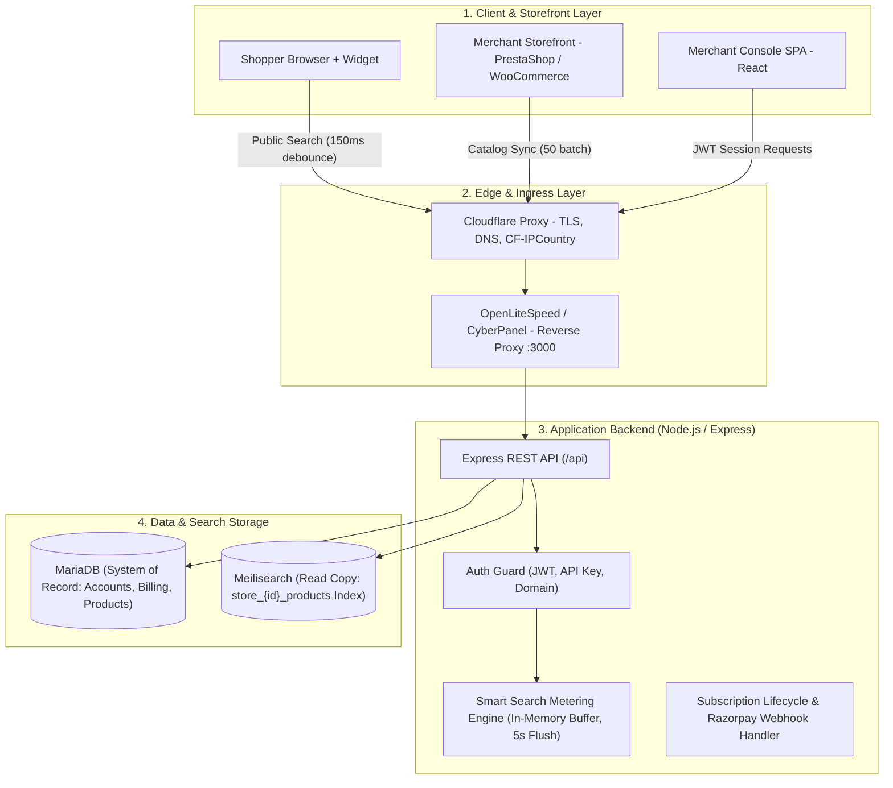

# Cataseek — Architecture & Engineering Case Study

> **Commercial Disclaimer:** Cataseek is a proprietary B2B commercial SaaS product engineered at **Gofenice Technologies**. This repository serves as an independent **System Architecture, Engineering Case Study, and Technical Documentation** authored by **Anoop Muhammed** (Lead Developer). No proprietary source code, credentials, or private API keys are shared.

---

## 📌 Executive Overview

**Cataseek** is a hosted, multi-tenant eCommerce search service designed for small to mid-sized online stores running on **PrestaShop** and **WooCommerce**. 

Traditional eCommerce search engines query MySQL databases directly with strict `LIKE '%query%'` queries, resulting in high server load, zero typo tolerance, and lost sales when shoppers misspell keywords. Cataseek solves this by offloading search traffic from the merchant's server to a dedicated, high-speed indexing engine that delivers sub-25ms typo-tolerant search results directly in the shopper's browser.

---

## 🏗️ System Architecture & Data Flow

The platform is designed around a single-process TypeScript monolith running under **PM2**, managing API endpoints, background sweeps, in-memory search metering buffers, and database connections.

---

## ⚙️ Core Technical Highlights & Engineering Challenges

### 1. Multi-Tenant Isolation & Storage Architecture
* **Meilisearch Multi-Tenancy:** Each merchant account operates in strict isolation with its own dedicated index: `store_{tenant_id}_products`. Index and table names are resolved server-side from the authenticated API token—never from raw request parameters—preventing cross-tenant data leakage.
* **Separation of Concerns:** MariaDB acts as the persistent **System of Record** (products, billing history, audit logs), while Meilisearch acts as the ephemeral, lightning-fast **Read Cache** answering queries in under 25ms.

### 2. Smart Search Metering Algorithm (`search-metering.service.ts`)
In hosted search, billing per HTTP request penalizes real shoppers because typing forward or backspacing triggers multiple keystroke calls.
* **Typing Burst Aggregation:** Developed an in-memory session tracker that groups prefix requests (e.g., `swe` → `swea` → `sweate` → `sweater`) within a 60-second window into **one single billable search**.
* **Zero-Impact Asynchronous Flushing:** Search queries are served to the user immediately; analytics and billable counts are pushed into an in-memory buffer and flushed to MariaDB in 5-second batches, avoiding database write bottlenecks during flash traffic sales.
* **Bot & Short-Query Filtering:** Automatically discards empty queries, queries under 3 characters, and known web crawlers (Googlebot, curl) from consuming client plan limits.

### 3. CMS Connector Engine (PrestaShop & WooCommerce)
* **Real-Time Hook Synchronization:** Listens to product lifecycle events (`actionProductAdd`, `actionProductUpdate`, `actionProductDelete`) to dispatch real-time incremental syncs without full re-indexing.
* **Batch Payload Processing:** Supports bulk catalog onboarding via 50-item batches with automatic schema normalization (`external_id`, localized language keys, multi-store separation, attributes, and inventory quantities).

### 4. Automated Subscription & Multi-Currency Billing
* **Razorpay Lifecycle Management:** Integrated recurring billing supporting multi-currency pricing (USD, EUR, GBP, INR) based on Cloudflare's `CF-IPCountry` header and merchant preference.
* **Webhook Idempotency:** Implemented HMAC signature verification with unique event tracking to ensure billing events are resilient against network retries without duplicate charges.
* **Automated PDF Invoicing:** Headless invoice generation dispatched via transactional SMTP upon successful payment captures.

---

## 💻 Technology Stack

| Layer | Technologies |
| :--- | :--- |
| **Backend Runtime** | Node.js, TypeScript 5.9, Express.js |
| **Search Engine** | Meilisearch (Typo tolerance, faceted attributes, prefix search) |
| **Database** | MariaDB / MySQL (Connection pooling with automatic retry) |
| **Security & Auth** | JWT, Bcrypt, Helmet, Express-Rate-Limit, CORS, HMAC Signatures |
| **Frontend & Console** | React 19, React Router 7, Vite 5, Lucide Icons, Tailwind / Vanilla CSS |
| **CMS Plugins** | PHP 7.1–8.2, PrestaShop Module Architecture, WooCommerce Action Scheduler |
| **Infrastructure** | DigitalOcean Ubuntu Droplet, CyberPanel, OpenLiteSpeed, Cloudflare CDN/DNS, PM2 |
| **Payments & Tools** | Razorpay Subscriptions API, Nodemailer, PDFKit, Multer |

---

## 👨‍💻 Role & Contributions

As the **Lead Developer** on the project at Gofenice Technologies, my responsibilities encompassed:
- Designing the end-to-end REST API architecture and multi-tenant authentication layers.
- Configuring and optimizing Meilisearch index ranking rules (words, typo, proximity, attribute, sort, exactness).
- Engineering the custom PrestaShop connector module and frontend search modal widget.
- Architecting the billing redesign (`anoop-billing-redesign`), subscription lifecycle handling, and usage limit enforcement.
- Managing server deployment, PM2 process management, and Cloudflare reverse proxy routing.

---

## 📬 Contact & Inquiries

For technical inquiries or discussion regarding this architecture:
- **Developer:** Anoop Muhammed
- **Email:** [anoopmuhammed995@gmail.com](mailto:anoopmuhammed995@gmail.com)
- **LinkedIn:** [linkedin.com/in/anoopmuhammed](https://linkedin.com/in/anoopmuhammed)
